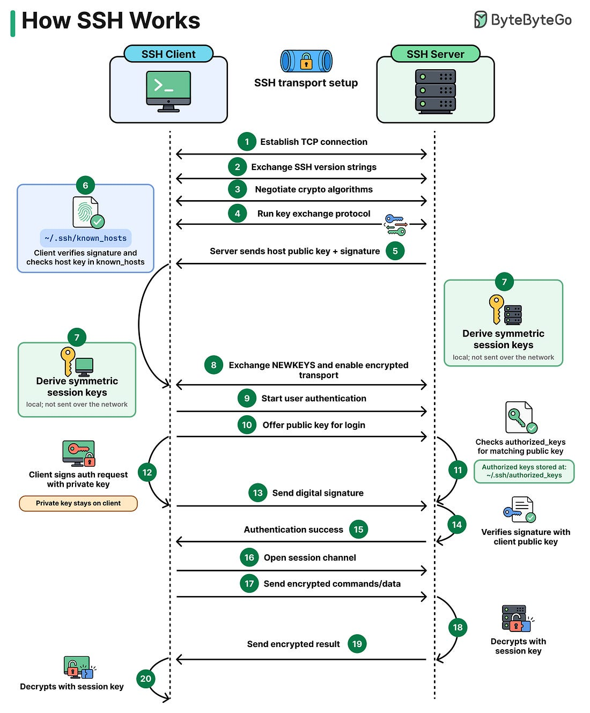

# Com funciona SSH: explicació de l’esquema pas a pas

Aquest document explica els **20 passos** del gràfic *How SSH Works*, de **ByteByteGo**. El gràfic mostra una connexió SSH amb **autenticació de l’usuari per clau pública**. Si l’accés es fa amb contrasenya, la preparació del canal segur és semblant, però canvia la manera d’autenticar l’usuari.



## Com hem de llegir el gràfic?

A l’esquerra hi ha el **client SSH**, el programa `ssh` del nostre ordinador. A la dreta hi ha el **servidor SSH**, el programa `sshd` de l’ordinador remot. El temps avança de dalt a baix. Les fletxes horitzontals representen comunicació; els requadres laterals representen càlculs o comprovacions locals.

Utilitzarem aquest exemple:

```bash
ssh alumne@192.168.56.10
```

La persona que executa l’ordre vol accedir al compte **`alumne` del servidor**. No cal que el seu compte a l’ordinador client es digui també `alumne`.

El procés té tres parts:

| Passos | Què volem aconseguir? |
|---|---|
| 1–8 | Preparar el canal xifrat i autenticar el servidor |
| 9–15 | Demostrar que podem accedir al compte remot |
| 16–20 | Obrir una sessió i intercanviar dades protegides |

**Primer comprovem el servidor; després el servidor comprova l’usuari.**

## Abans de començar: quines claus apareixen?

No totes les claus del dibuix són les mateixes ni tenen la mateixa funció:

| Claus o secrets | On es troben? | Funció |
|---|---|---|
| Parell de claus de host del servidor | La privada es queda al servidor; la pública es presenta al client | Autenticar el servidor mitjançant una signatura |
| Parell de claus d’autenticació de l’usuari | La privada es queda al client; la pública s’autoritza al compte remot | Autenticar l’usuari mitjançant una altra signatura |
| Secrets temporals de l’intercanvi de claus | Cada extrem genera el seu i no l’envia | Obtenir un secret compartit |
| Claus simètriques de sessió | Les calcula cada extrem localment | Xifrar i desxifrar el trànsit |

Les claus de host solen preparar-se en instal·lar o configurar el servei. Les de l’usuari es preparen prèviament amb `ssh-keygen` si volem accés per clau pública. Els secrets de l’intercanvi i les claus de sessió es preparen **automàticament durant la connexió**.

## Primera part: establir el canal segur

### 1. Establir la connexió TCP

El client es connecta a la IP o al nom del servidor i al port del servei SSH, habitualment **22/TCP**.

TCP proporciona una comunicació ordenada i fiable entre els dos programes, però **encara no tenim el xifratge d’SSH**. Obrir una connexió TCP no demostra que l’altre extrem sigui el servidor autèntic.

### 2. Intercanviar les cadenes de versió SSH

Client i servidor s’envien una línia d’identificació. Una línia com aquesta indica que es parla SSH versió 2 i identifica la implementació:

```text
SSH-2.0-OpenSSH_...
```

Aquesta identificació **no és una contrasenya ni una prova d’identitat**. Un programa maliciós també podria anunciar-se com un servidor SSH. A l’inici de la connexió, aquestes dades encara són visibles per a qui observa la xarxa.

### 3. Negociar els algoritmes criptogràfics

Els dos programes comuniquen quins algoritmes admeten i seleccionen opcions compatibles per a les diferents funcions:

- **Intercanvi de claus**, com Diffie-Hellman o una variant com ECDH.
- **Signatura del servidor**, per exemple amb claus ED25519 o RSA.
- **Xifratge simètric**, com AES o ChaCha20.
- **Protecció d’integritat**, per detectar modificacions dels paquets. Pot utilitzar un MAC o estar integrada en el mode de xifratge.

No és una tria que hagi de fer manualment l’alumne a cada connexió: la fan els programes segons les seves capacitats i configuracions.

**No es tria entre SHA-2, AES i RSA com si fessin la mateixa feina.** Un resum criptogràfic, un xifratge i una signatura resolen problemes diferents.

### 4. Executar l’intercanvi de claus

Cada extrem genera informació privada temporal i envia uns valors públics calculats a partir d’aquesta informació. Amb el seu secret privat i el valor públic rebut, cadascun obté **el mateix secret compartit**.

La idea de Diffie-Hellman és aquesta:

```text
Secret temporal del client + valor públic del servidor → secret compartit
Secret temporal del servidor + valor públic del client → el mateix secret compartit
```

Els secrets privats i el secret compartit **no viatgen per la xarxa**. Els valors públics sí que hi viatgen.

Aquí encara falta una pregunta: **hem acordat aquest secret amb el servidor correcte?** Un atacant actiu podria intentar interposar-se i fer dos intercanvis diferents. Per això necessitem els passos 5 i 6.

### 5. El servidor envia la seva clau pública de host i una signatura

El servidor presenta la seva **clau pública de host** i una signatura feta amb la **clau privada de host**.

La signatura es calcula sobre un resum que vincula les dades d’aquesta negociació, la clau de host, els valors de l’intercanvi i el secret compartit. Així el servidor demostra que disposa de la privada i vincula aquesta prova amb la connexió que s’està preparant.

**No envia la privada ni el secret compartit.** El client pot calcular el mateix resum perquè disposa de les dades necessàries i també obté el secret compartit.

El dibuix separa els passos 4 i 5 per explicar-los. En el protocol real estan relacionats: en DH clàssic, la resposta del servidor inclou el seu valor públic d’intercanvi, la clau de host i la signatura. No són necessàriament dues converses separades.

### 6. El client comprova la clau i verifica la signatura

S’han de superar **dues comprovacions**:

1. **La clau pública correspon al servidor esperat?** El client la compara amb la guardada per a aquella destinació a `~/.ssh/known_hosts`.
2. **La signatura és vàlida?** El client la verifica amb aquesta clau pública i amb el resum de l’intercanvi que ell mateix calcula.

Copiar la pública del servidor no permet suplantar-lo: falta generar la signatura vàlida sense disposar de la privada. Però una signatura vàlida amb la clau d’un atacant tampoc no ens serveix: cal comprovar que la pública és la del servidor esperat.

Si és la primera connexió, encara no hi ha una clau guardada. El client mostra una empremta i pregunta si l’acceptem. Cal contrastar-la per un canal fiable, per exemple des de la consola del servidor a VirtualBox:

```bash
ssh-keygen -lf /etc/ssh/ssh_host_ed25519_key.pub
```

Aquesta ordre consulta la clau ED25519; si el client presenta un altre tipus de clau, cal consultar la pública corresponent. **Contestar `yes` desa la clau presentada; no genera claus d’usuari ni substitueix la comprovació de l’empremta.**

### 7. Els dos extrems deriven les claus simètriques de sessió

Aquest número apareix dues vegades al gràfic perquè **el càlcul es fa als dos ordinadors**.

Derivar vol dir aplicar una funció al secret compartit i a dades de l’intercanvi per obtenir les claus que necessita el canal. Com que tots dos tenen el mateix material de partida, calculen les mateixes claus corresponents sense enviar-les.

Es preparen claus diferents per a cada sentit de comunicació i, quan cal, material per protegir la integritat. La clau de xifratge client → servidor no té per què ser la mateixa que la de servidor → client.

Per tant, no apareix cap clau secreta de manera màgica: **l’intercanvi permet calcular el mateix secret i la derivació el transforma en les claus necessàries**.

### 8. Intercanviar NEWKEYS i activar el transport xifrat

`NEWKEYS` és el nom d’un missatge de control que indica el canvi als algoritmes i claus acabats de preparar. **Malgrat el nom, no conté les claus secretes.**

Cada extrem envia el seu missatge i passa a utilitzar les noves claus per als missatges següents que envia; quan rep el de l’altre extrem, passa a utilitzar-les per llegir els missatges següents que rep.

Des d’aquest punt, l’autenticació de l’usuari i les dades posteriors circulen pel canal protegit. **Ja tenim el servidor autenticat i el canal xifrat, però l’usuari encara no ha iniciat sessió.**

## Segona part: autenticar l’usuari amb una clau

### 9. Començar l’autenticació de l’usuari

El client inicia el servei d’autenticació d’SSH i indica el compte remot al qual vol accedir, en l’exemple `alumne`.

El servidor aplica les seves regles: quins comptes poden entrar i quins mètodes d’autenticació admet. El gràfic continua amb el mètode **clau pública**.

### 10. Oferir una clau pública per accedir al compte

El client pot presentar la **clau pública d’autenticació de l’usuari** per preguntar si el servidor l’acceptaria per a aquell compte.

Aquesta no és la pública de host del pas 5: aquella identifica el servidor; aquesta serveix per autenticar-se com a usuari.

La consulta prèvia sense signatura és **opcional**. El client també pot enviar directament una petició signada. El gràfic mostra el camí amb consulta prèvia i simplifica la resposta del servidor que indica que es pot provar aquesta clau.

### 11. El servidor comprova authorized_keys

En la configuració habitual del laboratori, el servidor busca la clau presentada a:

```text
~/.ssh/authorized_keys
```

Aquí `~` és el directori personal del **compte remot al servidor**. Si el compte és `alumne`, habitualment parlem de `/home/alumne/.ssh/authorized_keys`.

La clau s’hi ha afegit prèviament, per exemple amb `ssh-copy-id`. Trobar-la vol dir que està autoritzada per a aquell compte, amb les restriccions que hi pugui haver. **Encara cal demostrar que el client disposa de la privada corresponent.**

### 12. El client signa la petició amb la seva clau privada

El client prepara una petició d’autenticació que queda vinculada a aquesta sessió i al compte remot, i la signa amb la **privada de l’usuari**, habitualment desada en un fitxer com `~/.ssh/id_ed25519` del client.

Si el fitxer està protegit amb una frase de pas, es pot demanar per desbloquejar-lo localment, o se’n pot gestionar l’ús amb un agent d’autenticació. Aquesta frase de pas **no és la contrasenya del compte remot**.

La privada es fa servir localment per signar: **no s’envia al servidor**.

### 13. Enviar la signatura digital

El client envia la petició signada pel canal que ja està xifrat. La signatura prova la possessió de la privada sense haver de transmetre-la.

Com que la petició signada incorpora l’identificador de la sessió, una signatura capturada no serveix per autenticar una altra connexió diferent. No es tracta d’enviar sempre una mateixa «prova secreta» reutilitzable.

### 14. El servidor verifica la signatura amb la pública de l’usuari

El servidor verifica la signatura amb la clau pública autoritzada i les dades de la petició. Així comprova que el client disposa de la privada corresponent i que la prova és vàlida per a aquesta sessió.

**La pública verifica; no desxifra cap repte enviat al client.** En aquest procediment, el servidor no necessita conèixer la privada.

### 15. El servidor comunica que l’autenticació ha tingut èxit

Si la clau està autoritzada, la signatura és vàlida i la política del servidor ho permet, es comunica l’èxit de l’autenticació.

El gràfic pressuposa que aquesta autenticació és suficient. Un servidor podria exigir factors addicionals, però això queda fora de l’exemple.

A partir d’aquí podem accedir al compte `alumne`, però **no obtenim automàticament permisos de root**. Les accions disponibles depenen dels permisos del compte i de les regles del sistema.

## Tercera part: utilitzar la connexió

### 16. Obrir un canal de sessió

Dins de la connexió SSH ja establerta, el client demana un **canal de sessió** i el servidor ha d’acceptar-lo.

Un canal és una comunicació lògica dins de la mateixa connexió; no implica obrir una altra connexió TCP. Després es pot demanar una consola interactiva, executar una ordre o iniciar un subsistema com SFTP.

En l’exemple `ssh alumne@192.168.56.10`, habitualment es demana un terminal i una consola de comandes del compte remot. El gràfic agrupa aquestes operacions en un sol pas.

### 17. Enviar comandes o dades xifrades

Si escrivim una ordre com `whoami`, el client transporta les dades del terminal dins del canal SSH. Les protegeix amb les claus simètriques i el mecanisme d’integritat negociats.

Les dades del terminal poden enviar-se a mesura que escrivim: no cal imaginar cada ordre sencera com un únic paquet. Qui captura el trànsit a la xarxa no veu l’ordre en clar, tot i que pot observar informació com les IP, els ports i el volum de trànsit.

### 18. El servidor desxifra i processa les dades

El servidor comprova la integritat de les dades rebudes segons el mecanisme negociat i les desxifra. Les entrega a la consola o al programa que gestiona el canal.

En l’exemple, `whoami` s’executa **al servidor** amb la identitat del compte remot. Per això esperem que retorni `alumne`, independentment del nom del compte al nostre ordinador.

El servidor pot llegir les dades perquè és un extrem de la connexió. **El xifratge protegeix el trajecte, no oculta les ordres al servidor que les ha d’executar.**

### 19. El servidor envia el resultat xifrat

El servidor recull la sortida del programa, la protegeix i l’envia pel canal SSH. Utilitza el material de claus corresponent al sentit **servidor → client**.

El resultat de `whoami`, per exemple, torna xifrat. La comunicació és bidireccional encara que el dibuix representi una ordre i una resposta per separat.

### 20. El client desxifra el resultat i el mostra

El client comprova la integritat i desxifra les dades rebudes. Finalment les mostra al terminal:

```text
alumne
```

El cicle d’enviar dades i rebre resultats es repeteix mentre utilitzem la sessió. Quan fem `exit`, es tanca la consola remota i, en una connexió senzilla sense altres canals oberts, també acaba la connexió SSH.

## Què canviaria si entréssim amb contrasenya?

Es mantindria la preparació del canal segur i l’autenticació del servidor dels passos 1–8. Els passos 10–14 de prova amb la clau de l’usuari se substituirien per l’enviament de la contrasenya del compte remot **dins del canal ja xifrat** i la comprovació que en fa el servidor.

Per tant:

- No cal generar claus d’usuari per poder establir una connexió SSH amb contrasenya.
- La comprovació de la clau de host del servidor continua sent necessària.
- La contrasenya viatja protegida pel xifratge; la privada de l’usuari, en l’altre mètode, no viatja.

## Dos fitxers amb funcions oposades

| Fitxer | On és, en aquest exemple? | Què conté? | Quina pregunta ajuda a respondre? |
|---|---|---|---|
| `~/.ssh/known_hosts` | Al client, dins del compte local | Claus públiques dels servidors de confiança | Estic parlant amb el servidor esperat? |
| `~/.ssh/authorized_keys` | Al servidor, dins del compte remot | Claus públiques autoritzades per accedir a aquell compte | Aquesta clau està autoritzada per entrar en aquest compte? |

Cap d’aquests fitxers conté les claus privades ni les claus simètriques de sessió. Les llistes de claus públiques **no substitueixen la verificació de les signatures**.

## Com observar-ho en una connexió real

Al client podem demanar informació de depuració:

```bash
ssh -vv alumne@192.168.56.10
```

Els missatges permeten observar la versió, els algoritmes negociats, la clau de host, el canvi a les noves claus, els intents d’autenticació i l’obertura del canal. El text exacte varia segons la versió i la configuració; no hem d’esperar una línia per cada número del dibuix.

Podem utilitzar aquesta sortida per identificar **quan es prepara el canal segur, quan s’autentica l’usuari i quan s’obre la sessió**. No mostra les claus secretes de sessió per poder-les copiar.

## Referències per contrastar els detalls

El gràfic original és de **ByteByteGo**, tal com indica la imatge aportada. La numeració d’aquest document segueix el gràfic; els matisos sobre missatges i passos opcionals es poden contrastar a:

- [RFC 4253 — Transport SSH](https://www.rfc-editor.org/rfc/rfc4253.html): intercanvi de claus, autenticació del servidor i activació amb `NEWKEYS`.
- [RFC 4252, apartat 7 — Autenticació per clau pública](https://www.rfc-editor.org/rfc/rfc4252.html#section-7): consulta opcional de la clau i petició signada vinculada a la sessió.
- [RFC 4254, apartat 6 — Canals de sessió](https://www.rfc-editor.org/rfc/rfc4254.html#section-6): obertura del canal i peticions de terminal, consola o execució.
- [Manual d’OpenSSH: ssh](https://man.openbsd.org/ssh): ús del client, autenticació i opció de depuració `-v`.
